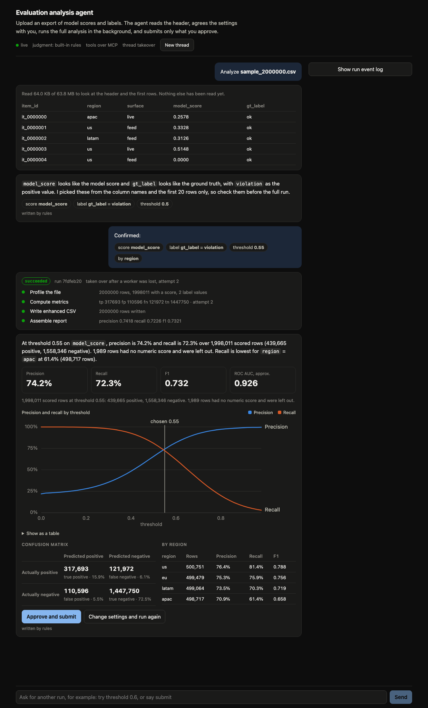

# durable-agent-runner

[](https://github.com/etherimirr/durable-agent-runner/actions/workflows/test.yml)

An analysis agent that can be trusted with a long job. You give it a CSV export of model scores and ground-truth labels. It looks at the header, agrees the settings with you, runs the full analysis in the background, shows you the report, and submits it only when you say so.

The interesting part is what happens when things go wrong. A worker can be killed halfway through a two-million-row scan, the API process can restart, the page can be reloaded, and the conversation picks up where it was.



## How it is put together

```
React + TypeScript panel
   │  POST /api/threads/{id}/start | resume        snapshots over SSE
   ▼
Agent harness (LangGraph)          checkpoint per thread in SQLite
   preview ─▶ confirm ─▶ launch ─▶ wait_run ─▶ report ─▶ review ─▶ submit
   │               ▲ waits for you    ▲ waits for the run   ▲ waits for you
   │  tools over MCP (stdio)
   ▼
Durable runner                     runs, steps and events in SQLite
   API ── short ACK ──▶ queue ◀── lease + heartbeat ── workers
                                   each step in its own process group
```

There are two layers and each can be used without the other.

**The runner** (`src/dar`) takes a job, returns at once, and gets the job done even if workers die. It knows nothing about agents.

**The harness** (`src/harness`) is the agent. It is a LangGraph state machine with three places where it stops and waits: for you to confirm the settings, for the background run to finish, and for you to approve the report. Each wait is a LangGraph interrupt, so the state of every conversation is a checkpoint on disk.

## The rules the agent follows

**Quick reads answer now. Anything that scans the file goes to the background.** `preview_dataset` reads at most 64 KB, however large the file is. The full analysis is four steps in a durable run: profile the file, compute metrics, write an enhanced CSV, assemble the report.

**Nothing runs until you confirm.** The agent proposes which column is the score, which is the label, and what counts as positive, from the header and the first 20 rows. You can change them in the form or in words ("threshold 0.7, slice by region").

**A report is not a submission.** Files reach the outbox only through `submit_report`, and the graph calls it only after an explicit approval.

**The graph decides what happens next. The model only fills in judgment.** Three things need judgment: guessing the columns, reading a typed instruction, and wording the summary. Each has a rule-based version that always works. When Anthropic credentials are present, Claude is tried first with structured output, and its answer is checked against the real column names before it is used. A refusal, an API error, or an answer that fails the check falls back to the rules.

## What it guarantees

| Situation | What happens | Test |
|---|---|---|
| Worker is killed with SIGKILL mid-step | Another worker takes over when the lease expires. Finished steps are not run again. The interrupted step runs again from a clean directory. | `test_killed_worker_is_replaced_and_finished_steps_are_not_rerun` |
| The dead worker's step is still running | It is not. A supervisor watches its parent and kills the step's process group. | same test, 1.5 s deadline |
| A stalled worker wakes up after being replaced | Every write carries a fencing token. Its writes are rejected. | `test_stale_worker_cannot_write_after_its_lease_was_taken` |
| 16 workers race for one run | Exactly one gets it. | `test_only_one_of_many_racing_workers_claims_a_run` |
| The agent process restarts while a run is in flight | On startup it rebuilds the list of waiting threads from the checkpoints and wakes each one when its run ends. | `test_restart_between_launch_and_result_loses_nothing` |
| Run is submitted twice for one thread | The second request returns the run already active. | `test_one_active_run_per_thread` |
| Settings name a column that does not exist | Rejected before any run starts, and the earlier settings are kept. | `test_bad_input_never_starts_a_run` |
| A step fails in the sandbox | The thread returns to the settings with the step's own error message. | `test_cancel_and_failed_run_return_to_the_settings` |
| Cancel while running | The step's process group is killed within one heartbeat. | `test_cancel_running_run_kills_its_process` |
| Browser reconnects or reloads | The run log resumes from the last event id with no gap and no repeat. The thread id alone restores the page. | `test_http_submit_ack_stream_and_resume` |
| Model returns a column that is not in the file | Discarded, rules used instead. | `test_claude_advisor_falls_back_to_rules` |

The metrics are checked against an independent count in the tests, for the whole file and for each slice.

For the first three rows I also checked the reverse: with the mechanism removed, the test fails.

## Measured

Apple silicon laptop, 14 cores, macOS, Python 3.12. Reproduce with `python bench/bench.py`.

Time from SIGKILL of the owning worker to another worker taking over, with a standby worker already polling:

| Lease | Trials | Median takeover | p95 | Max |
|---|---|---|---|---|
| 0.5 s | 10 | 0.44 s | 0.49 s | 0.49 s |
| 1 s | 10 | 0.88 s | 1.01 s | 1.01 s |
| 2 s | 10 | 1.70 s | 2.04 s | 2.04 s |
| 5 s | 10 | 4.06 s | 4.72 s | 4.72 s |

Takeover is bounded by the lease length, because a worker renews every third of a lease.

Throughput on trivial two-step runs:

| Workers | Runs | Runs per second |
|---|---|---|
| 1 | 200 | 6.7 |
| 2 | 200 | 13.5 |
| 4 | 200 | 25.9 |
| 8 | 200 | 50.8 |

The per-run cost is starting four processes, which is the right place for it when real steps take seconds or minutes.

The screenshot above is a 2,000,000-row file (64 MB). The worker was killed during the metrics step. The run finished on its second attempt, with that step repeated once and the others run once.

## Run it

```bash
pip install -e ".[dev]"
pytest -q
```

```bash
npm --prefix web ci && npm --prefix web run build
```

Start the service, then a worker, then open http://127.0.0.1:8000.

```bash
DAR_DATA=data uvicorn --factory harness.app:app_from_env
```

```bash
python -m dar.worker --db data/dar.db --workspace data/ws --id a --lease-ttl 2
```

Press "Generate a 200,000-row sample", then Analyze. To watch a takeover, generate a larger sample through the API (`POST /api/datasets/sample?rows=2000000`), start the analysis, kill the worker, and start another with `--id b`.

| Variable | Default | Meaning |
|---|---|---|
| `DAR_DATA` | `data` | Where the databases, datasets, workspace and outbox live |
| `DAR_TOOLS` | `mcp` | `mcp` starts the tool server as a subprocess over stdio. `direct` calls the tools in-process. |
| `DAR_LLM` | `auto` | `off` forces the rule-based advisor |
| `DAR_MODEL` | `claude-opus-5-5` | Model used when credentials are present |
| `DAR_EFFORT` | `low` | Effort level for the model calls |

## The tools as an MCP server

The agent's seven tools are a standalone MCP server, so any MCP client can drive the same analysis.

```bash
DAR_DATA=data python -m harness.mcp_server
```

`list_datasets`, `preview_dataset`, `start_analysis`, `get_run`, `cancel_run`, `read_report`, `submit_report`.

## HTTP API

| Method | Path | Purpose |
|---|---|---|
| GET, POST | `/api/datasets` | List files, upload a CSV |
| POST | `/api/datasets/sample?rows=N` | Generate a synthetic export |
| POST | `/api/threads/{id}/start` | Begin an analysis of a dataset |
| POST | `/api/threads/{id}/resume` | Answer the agent: `confirm`, `redo`, `submit`, `cancel`, or a `message` in words |
| GET | `/api/threads/{id}` | Current state of the conversation |
| GET | `/api/threads/{id}/events` | The same state as a stream of snapshots |
| POST | `/threads/{id}/runs` | Runner: submit any job. Returns `202`. |
| GET | `/runs/{id}/stream` | Runner: event log over SSE. Honors `Last-Event-ID`. |
| POST | `/runs/{id}/cancel` | Runner: request cancellation |

## Limits

- The model path has unit tests against a stand-in client that check the request shape and every fallback. It has not been run against the live API from this repository. Without credentials the agent runs on rules.
- When the model is on, the header and the first 20 rows of the file are sent to it for the column guess, and the metrics for the summary. Nothing else leaves the machine.
- The interrupted step runs again, so a step must be safe to repeat. Its files are isolated. Effects outside its directory are not.
- State is in SQLite, which means one machine and one agent process. The lease and fencing logic maps onto `SELECT ... FOR UPDATE SKIP LOCKED` in Postgres.
- The sandbox is a process group with a scrubbed environment and CPU and file-size limits. It protects against accidents. It is not a security boundary against hostile code.
- The threshold sweep comes from a 200-bin histogram, so the best-F1 threshold and the ROC area are approximate. The confusion matrix at the chosen threshold is exact.

## License

MIT
